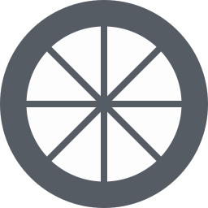
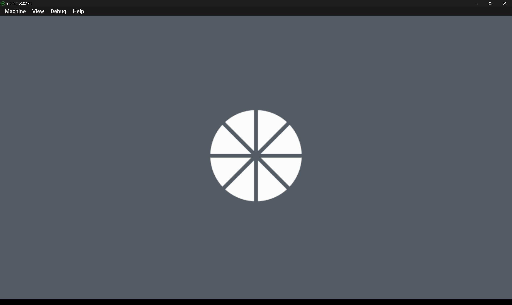
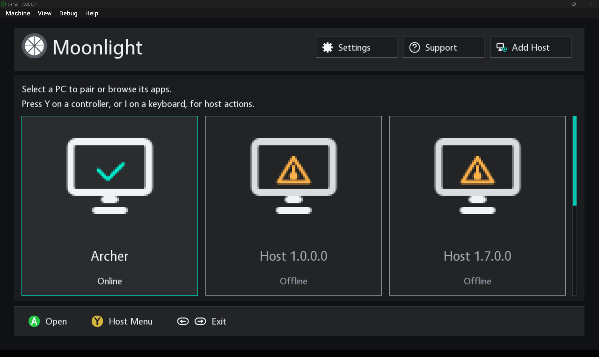
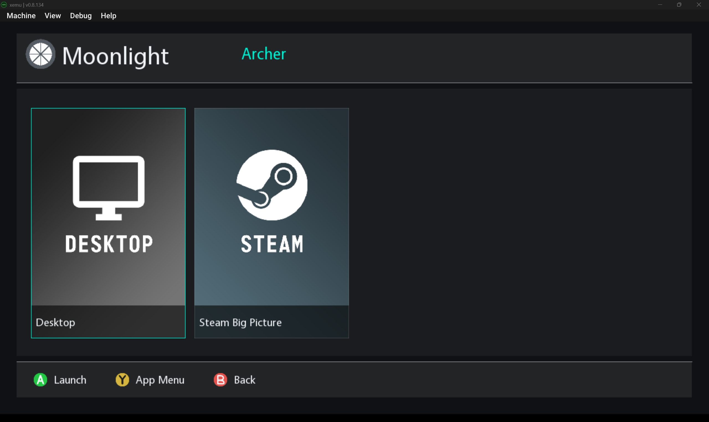

<div align="center">
  
  <h1 align="center">Moonlight-XboxOG</h1>
  <h4 align="center">Port of Moonlight for the Original Xbox.</h4>
</div>

<div align="center">
  <a href="https://github.com/SunshineStream/Moonlight-XboxOG"></a>
  <a href="https://github.com/SunshineStream/Moonlight-XboxOG/actions/workflows/ci.yml?query=branch%3Amaster"></a>
  <a href="https://codecov.io/gh/SunshineStream/Moonlight-XboxOG"></a>
  <a href="https://sonarcloud.io/project/overview?id=SunshineStream_Moonlight-XboxOG"></a>
</div>

# Overview






## Video codec selection

The streaming menu's **Video Codec** setting offers Auto, H.264, MPEG-2, and H.263+.
Auto prefers H.264, then MPEG-2, then H.263+, using only codecs advertised by the host.
An explicit choice requests only that codec and fails negotiation when it is unavailable.
Sunshine must enable `mpeg2_mode = 2` or `h263p_mode = 2` to advertise the corresponding legacy codec.
These Sunshine protocol extensions are available to any client implementing their negotiation and decoding.

The preference is saved as `streaming.video_codec` in the settings file. Existing
`streaming.video_decoder` preferences are read for compatibility; `video_codec` takes precedence when both exist.

## Streaming controls and statistics

To quit a stream, press **Back/Select + Black + White (LB + RB)** together on any connected controller.
The client displays **Stopping stream...**, then a stream summary. Release the buttons, then press a
button to return to the menu.

Enable **Settings → Display → Performance Stats** for a live panel during playback and additional
performance details in the summary. The panel works with GPU and software presentation, refreshes
once per second, and shows `N/A` for unavailable measurements. It includes measured incoming,
decoded and rendered FPS, video bitrate, timing, frame drops, buffering and the presentation path.
The stream header shows the requested FPS; the three FPS counters show measured rates.
Network latency is round-trip time. Present measures CPU frame preparation and submission,
including any scanout wait.

Video decoding runs on the CPU. Optional experimental GPU presentation accelerates color conversion
and scaling, with software fallback for unsupported frames or presentation failures. GPU
presentation is enabled by default; the build options below control its use.

Every stream summary reports GPU and software frame counts. **SOFTWARE FALLBACK USED** includes
the reason software presentation was selected, even when Performance Stats is disabled.

## 🛠️ Build

### Prerequisites

1. Clone the repository with submodules, or update them after cloning.

   ```bash
   git submodule update --init --recursive
   ```

2. Install nxdk prerequisites.

#### Windows

> [!NOTE]
> You must use the mingw64 shell on Windows.

```bash
pacman -Syu
nxdk_dependencies=(
  "bison"
  "flex"
  "git"
  "make"
  "mingw-w64-x86_64-cmake"
  "mingw-w64-x86_64-clang"
  "mingw-w64-x86_64-gcc"
  "mingw-w64-x86_64-lld"
  "mingw-w64-x86_64-llvm"
  "mingw-w64-x86_64-make"
  "mingw-w64-x86_64-nasm"
)
moonlight_dependencies=(
  "mingw-w64-x86_64-doxygen"
  "mingw-w64-x86_64-graphviz"
  "mingw-w64-ucrt-x86_64-nodejs"
)
dependencies=("${nxdk_dependencies[@]}" "${moonlight_dependencies[@]}")
pacman -S "${dependencies[@]}"
```

#### Debian/Ubuntu Linux

```bash
nxdk_dependencies=(
  "bison"
  "build-essential"
  "clang"
  "cmake"
  "flex"
  "git"
  "lld"
  "llvm"
  "nasm"
)
moonlight_dependencies=(
  "doxygen"
  "graphviz"
  "nodejs"
)
dependencies=("${nxdk_dependencies[@]}" "${moonlight_dependencies[@]}")
apt install "${dependencies[@]}"
```

#### macOS

```bash
nxdk_dependencies=(
  "cmake"
  "coreutils"
  "lld"
  "llvm"
  "nasm"
)
moonlight_dependencies=(
  "doxygen"
  "graphviz"
  "node"
)
dependencies=("${nxdk_dependencies[@]}" "${moonlight_dependencies[@]}")
brew install "${dependencies[@]}"
```

### Configure

Configure the top-level project with the normal host toolchain. CMake uses the vendored `third-party/nxdk` checkout, copies its tracked sources and nested submodules into the build directory, bootstraps the required `nxdk` outputs there, builds the host-native tests with the standard compiler/linker, and drives the Xbox build through an internal child configure that reuses the stock `nxdk` toolchain.

For host and Xbox builds, CMake checks whether the compiler supports Clang's `unused-but-set-global` warning. When supported, this warning remains nonfatal for `moonlight-common-c`, whose debug counters are read only by assertions that are disabled in release builds. Other warnings retain the dependency's existing error policy.

```bash
cmake -S . -B cmake-build-release -DBUILD_DOCS=OFF -DCMAKE_BUILD_TYPE=Release
```

Video build settings:

| CMake option                        | Default | Purpose                                                                                                                         |
| ----------------------------------- | ------- | ------------------------------------------------------------------------------------------------------------------------------- |
| `MOONLIGHT_ENABLE_GPU_PRESENTATION` | `ON`    | Enable experimental NV2A color conversion and scaling with software fallback.                                                   |
| `MOONLIGHT_BUILD_VIDEO_EXPERIMENTS` | `OFF`   | Build the standalone probes described in [Video experiments](experiments/README.md).                                            |
| `MOONLIGHT_INPUT_DIAGNOSTICS`       | `OFF`   | Show controller state and event counters for troubleshooting. Requires GPU presentation to be disabled so the strip is visible. |

Pass options when configuring, for example `-DMOONLIGHT_ENABLE_GPU_PRESENTATION=OFF` for software-only
presentation. Existing build directories retain their cached settings until explicitly reconfigured.

### Build

```bash
cmake --build cmake-build-release
```

### Combined script

This script takes care of everything, except installing the prerequisites.

```bash
./build.sh
```

The default build directory is `cmake-build-release`. You can override it or force a clean build:

```bash
./build.sh --build-dir cmake-build-debug
./build.sh --clean
./build.sh cmake-build-custom clean
```

To launch the same build from shells outside MSYS2 on Windows, use one of these wrappers:

```bat
build-mingw64.bat
```

```bash
./build-mingw64.sh
```

### Host-native unit tests

The Xbox executable cannot run directly on Windows, macOS, or Linux, so the top-level project builds `test_moonlight` natively while the Xbox binary is built by an internal child configure that uses the `nxdk` toolchain. Keep Xbox runtime code thin and move logic you want to test into platform-neutral sources that can be linked into `test_moonlight`.

#### Windows via MSYS2/mingw64

From `cmd.exe`, configure, build, and run the host tests after the helper locates your local MSYS2 installation:

```bat
call scripts\find-msys2.cmd && "%MOONLIGHT_MSYS2_SHELL%" -defterm -here -no-start -mingw64 -c "cd /c/Users/%USERNAME%/Dev/git/Moonlight-XboxOG && cmake -S . -B cmake-build-host-tests -DBUILD_DOCS=OFF -DBUILD_TESTS=ON -DBUILD_XBOX=OFF -DCMAKE_BUILD_TYPE=Debug && cmake --build cmake-build-host-tests --target test_moonlight && ctest --test-dir cmake-build-host-tests --output-on-failure"
```

If you are already inside a `mingw64` shell, the equivalent commands are:

```bash
cmake -S . -B cmake-build-host-tests -DBUILD_DOCS=OFF -DBUILD_TESTS=ON -DBUILD_XBOX=OFF -DCMAKE_BUILD_TYPE=Debug
cmake --build cmake-build-host-tests --target test_moonlight
ctest --test-dir cmake-build-host-tests --output-on-failure
```

#### Linux or macOS

```bash
cmake -S . -B cmake-build-host-tests -DBUILD_TESTS=ON -DBUILD_XBOX=OFF -DBUILD_DOCS=OFF
cmake --build cmake-build-host-tests --target test_moonlight
ctest --test-dir cmake-build-host-tests --output-on-failure
```

Coverage should come from this host-native test build instead of the cross-compiled Xbox build.

### Dependency compatibility on Xbox

The SDK submodule tracks upstream XboxDev/nxdk, including its upstream PDCLib. Moonlight's
Xbox adapters live in `src/_nxdk_compat` and are built by `cmake/nxdk-compat.cmake`.
All SDK libraries, host tools and generated lwIP files are built under the build
directory, including for direct Xbox presets. `cmake/nxdk-toolchain.cmake` prepares
that copy before compiler checks and then loads the stock nxdk toolchain. SDK
revision changes and local edits to tracked SDK files refresh the copy; unrelated
untracked files and existing build products are excluded. `MOONLIGHT_NXDK_DIR`
selects the source checkout; `MOONLIGHT_NXDK_BUILD_DIR` selects the build copy.

The local network target builds upstream lwIP with the streaming receive limits,
socket options and mDNS enabled. The `network/nxdk-network.patch` compatibility
patch is applied with `git apply` to build-directory copies, preserving thread
priorities and safe packet drops on receive-pool exhaustion. The submodule
sources stay unchanged. `nxNetInit` is compiled with the same settings so its
network-interface layout matches lwIP.

The compatibility layer provides real wall-clock, sleep and reentrant string helpers.
FFmpeg's unused POSIX descriptor/file helpers and OpenSSL's optional POSIX directory
and metadata queries fail explicitly with `ENOSYS`. Moonlight's Win32 file APIs,
standard stdio and custom OpenSSL socket BIO continue to handle saved data and pairing.
FFmpeg configure probes still link actual Xbox libraries and the local timing helpers.

OpenSSL disables POSIX descriptor I/O; its socket BIO leaves socket ownership with
the caller. FFmpeg builds its original file helpers through its generic platform
path, with memory mapping and temporary-file creation disabled.

### CLion on Windows

The Windows preset in `CMakePresets.json` uses `MinGW Makefiles` for the host-native CLion build, auto-detects the local MSYS2 installation through `cmake/host-mingw64-clang.cmake`, and delegates the Xbox child build through a dedicated CMake driver that enters the vendored `nxdk` environment only for the child configure and build steps.

1. Open the project in CLion and import the `nxdk-release (mingw64)` preset from `CMakePresets.json`.
2. Use the normal build button with that profile selected. The top-level build will compile `test_moonlight` natively and configure the Xbox child build automatically.
3. When you use CLion's **Reset Cache and Reload Project**, the next configure will clean the `nxdk` build outputs and rebuild the required `nxdk` libraries and tools.
4. Build the `moonlight_xbox` target or the default `all` target. The generated ISO now lives at `cmake-build-release/xbox/Moonlight.iso`.

For the first xemu launch, you can either run the shared `Setup portable xemu` configuration or run the Windows wrapper manually:

```bat
scripts\setup-xemu.cmd
```

The repository now includes `.run/Run xemu.run.xml`, which launches `scripts\run-xemu.cmd` through `C:\Windows\System32\cmd.exe` without extra arguments and lets the launcher auto-discover a built Moonlight ISO.

If you create a local CLion run configuration that sets the working directory to a build output such as `$CMakeCurrentBuildDir$/xbox`, the Windows wrapper also treats that caller working directory as the xemu target path when no explicit launcher arguments or `MOONLIGHT_XEMU_*` overrides are provided.

The setup script downloads xemu and the emulator support files into `.local/xemu`, then refreshes launcher manifests used by `scripts/run-xemu.sh`. Existing files under `.local/xemu` are preserved by default so a local xemu install or support bundle is not overwritten unless you pass `--force`. The launcher accepts `MOONLIGHT_XEMU_BUILD_DIR`, `MOONLIGHT_XEMU_ISO_PATH`, `--build-dir <cmake-build-dir>`, `--iso <iso-path>`, or a single positional path that can point at either a build directory or an ISO file. If you do not pass a path, it falls back across available `cmake-build-*` outputs and prefers the newest built ISO.

When xemu runs with its default user-mode network, multicast mDNS traffic is not forwarded reliably, so automatic host discovery may not find your PC. For reliable discovery, launch xemu with `--network tap --tap-ifname <adapter>` or add the host manually from the Xbox UI.

If you only want the emulator without the ROM/HDD support bundle, run:

```bat
scripts\setup-xemu.cmd --skip-support-files
```

> [!NOTE]
> You can set Xemu to use widescreen mode by using https://github.com/Ernegien/XboxEepromEditor
> but 1080i does not work in Xemu.

## 📋 Todo

- Build
   - [x] Build in GitHub CI
   - [x] Build with CMake instead of Make, see https://github.com/Ryzee119/Xenium-Tools/blob/master/CMakeLists.txt and https://github.com/abaire/nxdk_pgraph_tests/blob/4b7934e6d612a6d17f9ec229a2d72601a5caefc4/CMakeLists.txt
   - [x] Get build environment working with CLion directly instead of using external terminal
      - [ ] debugger, see https://github.com/abaire/xbdm_gdb_bridge
   - [x] Add a run config for CLion, see https://github.com/Subtixx/XSampleProject
   - [x] Automatically run built xiso in Xemu
   - [x] Add unit testing framework
      - [x] Separate main build and unit test builds, due to cross compiling, see https://stackoverflow.com/a/64335131/11214013
      - [x] Get tests to properly compile
      - [x] Enable codecov
   - [x] Enable sonarcloud
   - [x] Build moonlight-common-c
      - [x] Build custom enet
   - [x] Docs via doxygen
- Menus / Screens
   - [x] Loading/splash screen
      - [x] Initial loading screen, see https://github.com/XboxDev/nxdk/blob/master/samples/sdl_image/main.c
      - [x] Set video mode based on the best available mode
      - [x] dynamic splash screen (size based on current resolution)
      - [x] simplify (draw background color and overlay logo) to reduce total size
   - [x] Main/Home
   - [x] Settings
   - [x] Add Host
   - [x] Game/App Selection
   - [x] Host Details
   - [x] App Details
   - [ ] Pause/Hotkey overlay
- Streaming
   - [x] Video - https://www.xbmc4xbox.org.uk/wiki/XBMC_Features_and_Supported_Formats#Xbox_supported_video_formats_and_resolutions
   - [ ] Audio
      - [ ] Mono
      - [ ] Stereo
      - [ ] 5.1 Surround
      - [ ] 7.1 Surround
- Input
   - [x] Gamepad Input
   - [ ] Keyboard Input
   - [ ] Mouse Input
   - [ ] Mouse Emulation via Gamepad
- Misc.
  - [x] Save config and pairing states
  - [x] Host pairing
  - [x] Auto host discovery
  - [ ] Possibly, GPU overclocking, see https://github.com/GXTX/XboxOverclock
